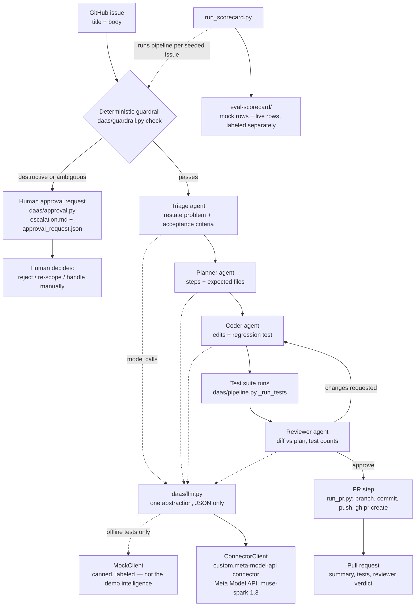

# Architecture — DevOps as a Service

One issue in → a tested pull request out, or a structured escalation.
This page is the Day-8 architecture artifact, written from the code as
it exists on Oct 25, 2026 — every component named below is a real file
in this repo, and `hackathon-agent-scaffold/tests/test_architecture.py`
pins that claim.

## System diagram

## The two paths

**Work path.** `daas/pipeline.py run()` first calls the guardrail,
then runs triage → planner → coder → reviewer through the single
`daas/llm.py` abstraction. The coder's edits are applied to a checked-out
branch, the demo repo's test suite runs, and the reviewer inspects the
diff against the planner's expected file set. Two deterministic checks
sit outside the models' control:

- **Unexpected-files check** — a run fails if it touches files outside
  the planner's expected set.
- **Live-coverage guard** — a live run only passes if the discovered
  test count grows past baseline (born from PR #15, whose regression
  test was inert; the guard held in the live PR #16 run, 6 → 8 tests).

**Escalation path.** The guardrail is deterministic code in
`daas/guardrail.py`, and it runs **before any model call**. A blocked
issue makes zero model calls: no agents run, no files change, no PR
opens. `daas/approval.py` renders that non-action into a human approval
request — what the pipeline provably did NOT do, the human's three
options (reject / re-scope / handle manually), and a blank, auditable
decision record — as `escalation.md` plus machine-readable
`approval_request.json`.

## Components

| Component | File | Responsibility |
|---|---|---|
| Guardrail | `hackathon-agent-scaffold/daas/guardrail.py` | Deterministic destructive/ambiguous-issue check (`check(title, body)`); runs before any model call. |
| Approval request | `hackathon-agent-scaffold/daas/approval.py` | `build_request` / `render_markdown` / `to_json`: the structured human handoff for an escalation. |
| LLM abstraction | `hackathon-agent-scaffold/daas/llm.py` | All model calls, JSON only. `ConnectorClient` (live, via the secure connector), `MetaModelClient` (direct API), `MockClient` (offline tests, labeled). Per-role models via `DAAS_MODEL_<ROLE>` env vars; every role defaults to `muse-spark-1.3`. |
| Pipeline | `hackathon-agent-scaffold/daas/pipeline.py` | `run(repo, issue, client, out_dir)`: guardrail → agents → edits → tests → review → PR body, plus the unexpected-files and live-coverage checks. |
| Prompts | `hackathon-agent-scaffold/daas/prompts.py` | Schema-pinned per-role prompts (triage, planner, coder, reviewer). |
| PR step | `hackathon-agent-scaffold/run_pr.py` | Branch → commit → push → `gh pr create` from the pipeline's PR body. |
| Eval scorecard | `hackathon-agent-scaffold/run_scorecard.py` | Re-runs the pipeline per seeded issue on fresh repo copies and publishes `eval-scorecard/`; mock and live rows are labeled separately. |
| Demo fallbacks | `hackathon-agent-scaffold/generate_demo_fallbacks.py` | Deterministically regenerates the mock half of `demo-fallbacks/`; never touches the captured live artifacts. |

## Trust boundaries

1. **Models never decide safety.** Whether an issue may proceed is
   decided by deterministic code before a model is consulted; a model
   cannot talk its way past the guardrail.
2. **Models never grade themselves alone.** Test execution, the
   unexpected-files check, and the live-coverage guard are code, not
   prompts — the reviewer agent's verdict is one input, not the gate.
3. **The API key never enters the repo.** Live calls go through the
   custom.meta-model-api connector (`ConnectorClient` when no env key
   is set); the key lives in the secure connection store.
4. **Mock is never dressed as live.** `MockClient` output, mock
   scorecard rows, and mock demo fallbacks are labeled MOCK wherever
   they appear; live evidence is captured verbatim with provenance.

## What is not built yet (honest status)

- The **approve-and-resume flow** behind the approval request — a human
  recording a decision and the pipeline resuming from it — is Days 5–6
  sprint work. The request format above is built and test-pinned; the
  resume flow is not claimed here.
- **Live Tier 2/3 runs** are Days 3–4 sprint work; the scorecard's live
  section carries the Tier-1 row (PR #16) and labels the rest pending.
- The **per-role model split** is a Day-1 (Oct 27) decision; the
  override mechanism exists and is tested, the split itself is not
  decided in this document.
